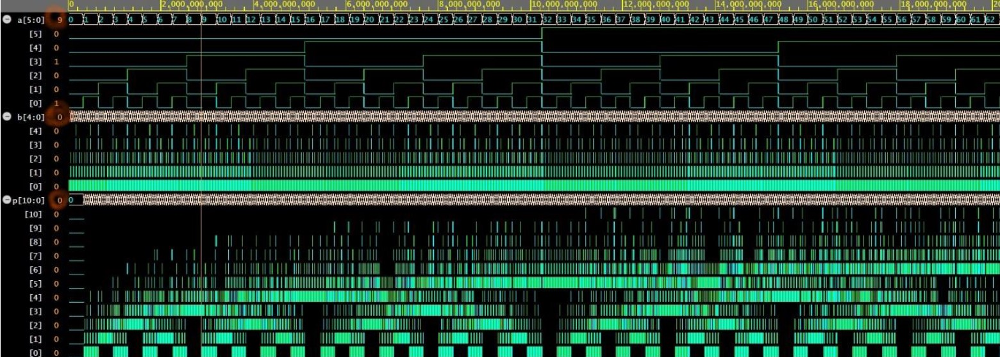
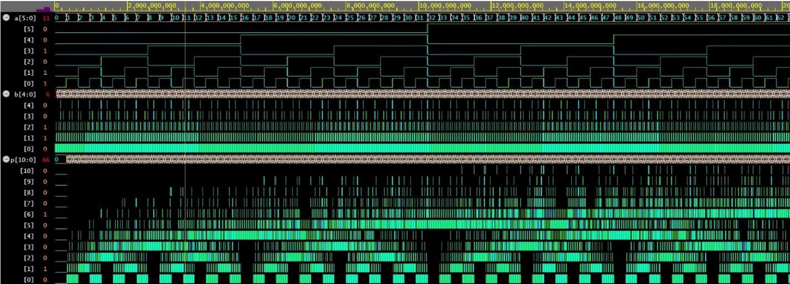

# Design and Implementation of a 6×5-Bit Array Multiplier

## 1. Project Objective

The objective of this project is to design and implement a binary multiplier capable of multiplying two unsigned binary numbers with input widths of 6 bits and 5 bits, respectively.

The circuit uses a **structural array multiplier architecture**, in which partial products are generated using AND gates and subsequently added together to produce the final multiplication result.

## 2. Circuit Description

The multiplier consists of two binary inputs and one binary output:

- **Input A:** A 6-bit unsigned binary number.
- **Input B:** A 5-bit unsigned binary number.
- **Output P:** An 11-bit binary number representing the multiplication result.

The maximum values representable by the two inputs are:

- Maximum value of A: \(2^6-1=63\)
- Maximum value of B: \(2^5-1=31\)

Therefore, the maximum multiplication result is: 63 * 31 = 1953

Since 2^ 10 = 1024 and 2^11 = 2048, an 11-bit output is sufficient to represent the entire range of possible results.

## 3. Operating Principle

The array multiplier performs multiplication through three main stages:

### 3.1. Partial Product Generation

In the first stage, each bit of the first input is combined with each bit of the second input using an AND gate.

Since the inputs contain 6 and 5 bits, respectively, a total of 30 partial product bits are generated.

Each partial product is calculated as:

PP_i,j = A_i AND  B_j

### 3.2. Partial Product Alignment

In the second stage, the generated partial products are aligned according to their bit positions.

Each partial product row is shifted to the left according to the position of the corresponding bit in the multiplier. This alignment ensures that each partial product contributes to the correct binary position in the final result.

### 3.3. Partial Product Addition

In the final stage, the aligned partial products are added together using full adders.

The addition process is organized into multiple stages, with carry bits propagated between adjacent bit positions. The final sum represents the product of the two input numbers.

## 4. Components Used in the Circuit

The main components of the array multiplier include:

1. **30 AND gates:** Used to generate the partial products from the two input operands.
2. **Five addition stages:** Used to combine the generated partial products.
3. **55 one-bit full adders:** Used to perform binary addition and handle carry propagation throughout the multiplier architecture.
4. **Two binary inputs:** One 6-bit input and one 5-bit input.
5. **One binary output:** An 11-bit output representing the final multiplication result.
--- 
 
9 * 0 = 0

 
11 * 6 = 66

